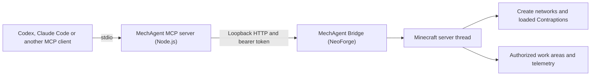

# MechAgent Bridge

MechAgent Bridge connects a local MCP client to Minecraft so it can inspect a Create factory, follow production, and make bounded changes in a work area you authorize. The project derives from [MCP Fabric](https://github.com/denfry/mcpfabric). It keeps the original MIT license, copyright and internal `mcpfabric` mod ID for compatibility.

[GitHub Release v1.0.0](https://github.com/Rxwkovo/mcBridge/releases/tag/v1.0.0) · [NeoForge JAR](https://github.com/Rxwkovo/mcBridge/releases/download/v1.0.0/mechagent-bridge-neoforge-1.0.0.jar) · [MCP server ZIP](https://github.com/Rxwkovo/mcBridge/releases/download/v1.0.0/mechagent-bridge-mcp-server-1.0.0.zip) · [SHA-256](https://github.com/Rxwkovo/mcBridge/releases/download/v1.0.0/SHA256SUMS.txt)



## Supported setup

| Component | v1.0.0 |
| --- | --- |
| Minecraft Java Edition | 1.21.1 |
| NeoForge | 21.1.248 |
| Create | 6.0.10 for Create tools |
| Java | 21 |
| Node.js for the MCP server | 22.16 or newer |

Mechanomania 1.1.13.1 is the complete reference pack. The NeoForge bridge can also start without Create and reports Create tools as unavailable. See the [compatibility matrix](docs/COMPATIBILITY.md).

## Install the mod and MCP server

1. Back up the world. Close Minecraft and place the GitHub Release JAR in the intended profile's `mods/` directory. Remove the prior MechAgent or MCP Fabric JAR from that directory. Both use the same mod ID.
2. Start the profile and enter a world. Open `config/mcpfabric.config.json` in that profile. Keep `host` at `127.0.0.1`, `requireAuth` at `true` and `accessMode` at `READ_ONLY` for observation. Copy the `readToken` privately to your MCP client environment as `MCPFABRIC_TOKEN`. Set `writeDiscoveryFile` to `false` if you prefer to use only explicit credentials, then restart Minecraft.
3. Extract the MCP server ZIP. In its extracted directory, run `npm ci --omit=dev --ignore-scripts`. The ZIP includes the compiled server and a lockfile. npm downloads the locked runtime dependencies. To build from the tagged source instead, run `npm ci` and `npm run build` inside `mcp-server/`.
4. Point your local MCP client at `node` and the absolute path to the extracted `dist/index.js`. Set `MCPFABRIC_URL` to `http://127.0.0.1:25599` or your configured port, and start with `MCPFABRIC_TOOLSETS=world,readonly`. The client starts the stdio server on demand.

Compare your downloads to `SHA256SUMS.txt`. On Windows use `Get-FileHash -Algorithm SHA256 <file>`. On Linux use `sha256sum -c SHA256SUMS.txt`.

### Codex and Claude Code

For Codex, set `MCPFABRIC_TOKEN` to the read token in the environment that launches Codex. Add the following to your user MCP configuration and replace the example path. For Claude Code, set the same environment variable before starting the client and add the JSON entry to your project MCP configuration.

```toml
[mcp_servers.mechagent]
command = "node"
args = ["/absolute/path/to/mechagent/dist/index.js"]
env_vars = ["MCPFABRIC_TOKEN"]

[mcp_servers.mechagent.env]
MCPFABRIC_URL = "http://127.0.0.1:25599"
MCPFABRIC_TOOLSETS = "world,readonly"
```

```json
{
  "mcpServers": {
    "mechagent": {
      "type": "stdio",
      "command": "node",
      "args": ["/absolute/path/to/mechagent/dist/index.js"],
      "env": {
        "MCPFABRIC_TOKEN": "${MCPFABRIC_TOKEN}",
        "MCPFABRIC_URL": "http://127.0.0.1:25599",
        "MCPFABRIC_TOOLSETS": "world,readonly"
      }
    }
  }
}
```

Use `codex mcp list` or `claude mcp list` to verify the entry. In the session, call `get_status` to confirm the connection and the loaded world. [Codex MCP reference](https://developers.openai.com/codex/mcp) · [Claude Code MCP reference](https://code.claude.com/docs/en/mcp)

### Permissions and example tools

The game server enforces permissions. The read token stays read-only, regardless of what tools the client shows. A trusted operator can opt into `REGION_BUILD` with a separate full token and a server-owned `mechagent-construction.json` that binds authorized areas to a world and dimension. Construction checks allowed blocks and expected state, requires a preview and commit, and records operations for recovery. Keep command, unrestricted world write, player control and admin flags disabled. Keep the HTTP bridge on loopback. [Work-area setup](docs/MECHAGENT-SETUP.md) · [Security policy](SECURITY.md)

| Goal | Example |
| --- | --- |
| Check a loaded shaft | `inspect_create_kinetic` with `{"x":10,"y":64,"z":20}`. Inspect signed actual and theoretical RPM. |
| See a network's load | `get_create_network_summary` with the same position. Compare cached capacity and consumption in SU. |
| Observe moving machinery | Call `list_moving_structures` with a position and radius, then pass the result's `structureId` to `inspect_moving_structure`, `get_structure_blocks` and `inspect_structure_motion`. |
| Follow production | Ask for `inspect_active_recipe` and `inspect_block_entity`. Where a monitor or meter exists, query `query_region_history` or `query_factory_meter`. |
| Make a scoped edit | Under `REGION_BUILD`, use `preview_batch_edit`, `commit_batch_edit` and `get_edit_operation`. See the setup guide for the expected-state and idempotency parameters. |

## PM12 factory

PM12 started with empty production inventories and one Create creative motor. With no external material added during the measured run, it produced 65 precision mechanisms in 86 minutes at about 20 TPS. The 65th item demonstrated continued production after the 64-item threshold. The observed 0.756 items/minute remained below the design target of 1 item/minute. [Case notes](docs/PM12.md)

## Troubleshooting and removal

- If the mod fails to load, check the exact game and loader versions, Java 21, and duplicate JARs with the `mcpfabric` mod ID. Verify which profile's `mods/` directory HMCL is using.
- If MCP cannot connect, enter a world, check the port, and verify the token came from the same profile. Install the ZIP's runtime dependencies and use an absolute path to `dist/index.js`.
- If a tool reports missing support or partial coverage, check the loaded chunk, dimension, Create version and access mode. `partial_restart_gap` marks a coverage gap across a reload. Factory Meter cannot guarantee exactly-once recovery.
- To uninstall, remove the MCP client entry, close Minecraft and move the JAR out of `mods/`. Retain your world backup and telemetry data if you want to preserve the history. Remove or rotate local bridge credentials if they were shared.

[Setup guide](docs/MECHAGENT-SETUP.md) · [Release history](CHANGELOG.md) · [Maintainer release process](docs/RELEASING.md) · [MIT License](LICENSE)
