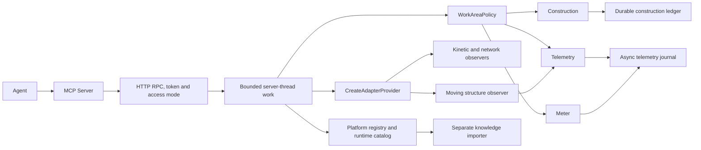
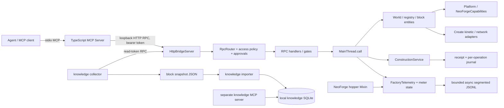
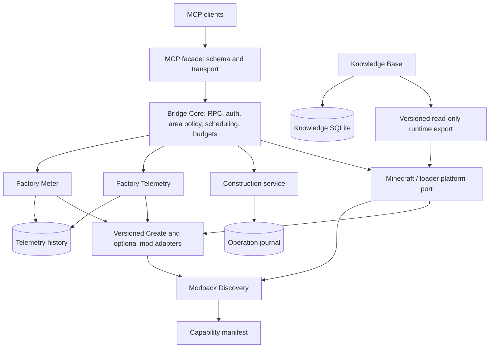

# MechAgent Bridge architecture

Status: architecture review of branch `mechagent-poc01-observation`, 2026-11-09. This describes the code present at review time; proposed interfaces are explicitly labelled. Mechanomania is an integration profile, not a product requirement. The `knowledge/` directory is independent untracked work and was inspected read-only; it is not part of the current Git baseline. Two untracked `scripts/rc1-fullpack-*.mjs` fixtures from the interrupted acceptance are also preserved.

## Implemented migration



`WorkAreaPolicy` shares validation across all three services. Each check reads the current bounded policy bytes and compares the canonical save paths. Only the parsed document is reused. Telemetry checks authorization when a sample is due. Construction retains its synchronous intent and progress writes.

`FactoryMeter` now owns the per-world counter and replay. Both observability services share `TelemetryJournal` and its asynchronous durability model. Telemetry allocates the shared sequence numbers. Existing record formats remain readable. Moving structures are sampled by opt-in monitors and only when their entity origin is within the authorized region.

`CreateAdapterProvider` uses platform loader metadata and exposes `KineticObserver`, `KineticNetworkObserver` and `MovingStructureObserver`. Native entity UUIDs are scoped to the current world and dimension. Member coordinates are local to the structure. Create's transform yields the captured world-space center at the observation tick. The observer stores bounded immutable pages of BlockState and transform data.

`get_runtime_catalog` exports paged live IDs and tag members. Combine it with environment metadata, registered block definitions and exact recipe reads. The external importer owns indexing and storage.

## Existing implementation before the migration



The main MCP server is an adapter, not the game server: `mcp-server/src/tools.ts` defines names, Zod schemas and hints; `toolsets.ts` filters exposure; `bridge.ts` and `discovery.ts` connect to the game. Agent runtime, dashboard and scripting are upstream features and remain outside the core changes proposed here. In Java, `McpFabric.init` registers handlers, router guards and HTTP; `AccessPolicy`, `ReadAccess`, `Gates`, token authentication and work-area checks are separate layers. A registered method or an MCP `readOnlyHint` alone is not authorization. `info.status.methods` is a catalogue, not proof that a method is currently usable.

`MainThread.call`, loader lifecycle entry points and server ticks enforce the game-thread boundary. `handlers/WorldHandlers`, `handlers/support/Levels`, `platform/Platform` and `neoforge/NeoForgeCapabilities` serve world/registry/unsided capability reads. A capability provider is arbitrary mod code and may exceed a soft budget; unavailable, unloaded and empty are different outcomes. NBT serialization remains unavailable until bounded handling is safe.

`adapters/CreateKineticAdapter`, `CreateNetworkAdapter` and `CreateNetworkJobs` access Create through reflection, with no Create types in public signatures. They read Create 6.0.10 fields, methods and network caches; they are not a general Create API. The single-call bounded snapshot and incremental job are different contracts: the former captures at most 256 members in a bounded subset; incremental jobs are bounded, cancellable, cross-tick and non-atomic. Network IDs may change after topology changes or restart; cached SU is not energy.

`construction/ConstructionService` owns area configuration, preview/commit, policy fingerprints, idempotency receipts, per-operation journals and reconciliation. Per-item reconciliation reports observed state, not a guarantee that external side effects were undone. The receipt and journal call filesystem operations including force on the server thread. `FactoryTelemetry` combines monitor definitions, sampling, policy verification, history jobs and meter state. `TelemetryJournal` batches bounded JSONL records on a background thread; its queue, quota and recovery statuses are operational limits, not per-record exactly-once receipts. Window calculations live in `TelemetryWindow` and scans in `TelemetryHistory`; they are bounded asynchronous scans, not an indexed database. `HopperHookMixin` / `meterprobe/HopperProbe` observe one NeoForge/Create depot→vanilla-hopper boundary. A successful extracted stack is checked against the same-call destination change; it is neither a general logistics hook nor a production counter. Policy verification currently rereads server-owned configuration on the server thread. The original opt-in Java `AcceptanceFixture` and its production hooks were removed in `9e40057`. The remaining fixtures run from isolated test scripts.

The separate `knowledge/` prototype collects blocks from `world.listRegisteredBlocks` using the read token, hashes local mod JARs and KubeJS files, imports into SQLite, and exposes its own read-only stdio MCP tools. Its schema contains future tables, but the importer and tool implementations presently index/query blocks and their legal properties only. The snapshot is cross-page and non-atomic; its completeness is explicitly false. `build.mjs` does not establish that the selected snapshot and scanned installation match, and fingerprints do not cover every configuration/datapack. It stores a local pack path. No main-server integration, automatic refresh, recipes/tags indexing, live rules or complete pack index should be inferred.

## Review findings and priorities

| Finding | Evidence / implication | Priority |
| --- | --- | --- |
| Create adapter combines feature logic, version check, loader discovery and internal reflection | `CreateKineticAdapter.createVersion`, `CreateNetworkAdapter` reflected `RotationPropagator.networks`; a field change may remove some or all results | Structural: isolate a versioned implementation and expose partial failure |
| World policy has two representations and synchronous verification | `FactoryTelemetry.loadPolicy` snapshot plus `ConstructionService.authorizesBounds` reading config; revocation and newly granted bounds have different visibility; per-transfer I/O costs matter | Structural: one authoritative fail-closed policy service, preserving revocation |
| Telemetry, meter and policy are coupled | `FactoryTelemetry` owns meter JSON state and calls the NeoForge-backed hook indirectly; cross-loader support and independent testing are hard | Structural: separate logical services and shared contracts, without forcing Gradle modules |
| Meter crash semantics span two independent stores | async meter journal and Minecraft world saves are not atomic; full-pack/minimal-world tests do not prove exact crash recovery | Release-blocking correctness: retain uncertainty and reconcile; do not promise exactly once |
| MCP discovery is incomplete | static tool catalogue, separate capability groups and access policy can disagree about effective authorization, Create version, hook applicability and limits | Structural: additive capability manifest, with authority evaluated server-side |
| Knowledge import lacks environment binding | separate `knowledge/` prototype records only partial fingerprint and operator-selected snapshot | Structural: provenance and match checks before indexing; coordinate with its owner |
| Data shapes are repeated | `BlockPos`/dimension/gameTime and status fields are hand-built in handlers, Create adapter, monitor and independent knowledge schema | Gradual shared envelopes; preserve existing wire formats during migration |
| Pack-specific example and fixture locations | `scripts/prepare-production-client.ps1`, `scripts/isolated-production-server.ps1`, `reports/`; explicitly hard-coded 6.0.10 and paths | Move under test profile/test source where feasible; do not mistake version adapter constants for pack coupling |
| Multiple bounded network APIs | summary, small snapshot and incremental jobs have different resource/consistency contracts | Keep: useful intentional distinctions; clarify discovery and avoid duplicating implementation |
| Legacy JSON and SQLite coexist | telemetry journal, construction ledger and independent knowledge SQLite represent different durability/access patterns | Keep separate stores; standardize identifiers and provenance, not a mandatory database merge |

## Target logical modules



Arrows represent required calls or dependency direction, not Java package imports already in place. Domain services consume ports; loaders implement ports and register supported adapters. Knowledge is a separate consumer: integration of its MCP process is a future decision coordinated with its owner, not a requirement to merge source or storage. Modpack Discovery is a proposed logical service, not currently implemented. Optional FTB Quests support is out of scope.

The target port surfaces should use immutable DTOs at boundaries: `WorldReader`, `ServerScheduler`, `WorkAreaPolicy`, `KineticObserver`, `TransferBoundaryObserver`, `TelemetryStore` and `EnvironmentDescriptor`. The adapter returns a structured availability status and a versioned observation; the service applies authorization and lifecycle rules. A scheduler accepts bounded work with explicit cancellation, ownership and expiration. The server thread captures only bounded game data; serialization, hashing, history scans and maintenance run off-thread. Access policy and privacy remain server-enforced; preserve default local binding, token gates and disabled broad mutation.

## Shared contracts and data flow

Proposed, additive v1 envelope; existing JSON remains authoritative until a documented migration:

```json
{"schemaVersion":1,"world":{"opaqueId":"…","generation":"…"},"dimension":"minecraft:overworld","position":{"x":0,"y":64,"z":0},"sample":{"gameTick":123,"wallTimeUtc":"2026-01-01T00:00:00Z","serverSessionId":"…"},"source":{"kind":"create_runtime","adapter":"create-6.0.10","freshness":"cached_may_be_stale"},"status":"partial","coverage":{"complete":false,"gaps":["restart"]},"value":null}
```

This is a design example, not a live response. World identity is opaque and scoped to a server installation; define copy/restore semantics before implementation and never expose raw filesystem paths, secret keys or reversible identifiers. Coordinates use integer block positions with dimension ResourceLocation; block state is registry ID plus validated property map. `gameTick` can roll back on world restore; session/generation and UTC distinguish discontinuities, not prove order or exact elapsed time. A network ID is session- and dimension-scoped with source position and observation tick, never permanent. A device identity combines scoped location and observed block-entity type; replacement yields a new epoch only when observed. Unknown fields are null/status with a reason, never synthetic zero.

Persist distinct records: immutable knowledge build (source, scope, fingerprint, non-atomic/completeness), runtime observation (sample and freshness), telemetry sample/change/gap, meter boundary event (direction, actual item/fluid quantity, source/target, adapter, event identity and coverage), and construction operation (idempotency signature, policy revision, before/after, progress, observed reconciliation). Cumulative transfer counters are boundary-specific; inventory net change and estimated output remain separate. SU is an instantaneous Create stress metric, not FE or cumulative energy. Missing periods, queue overflow, permissions, unload and restart are first-class coverage gaps. No atomicity is assumed across Minecraft save and external journal.

The existing 2026-11-09 full-pack work established world loading, read-only registry and recipe access; the later uncommitted local fixture observed water-wheel power, overload, disconnect, and one manual iron-ingot press and meter count. That latter work must be preserved and recorded separately before being treated as a checked-in regression baseline. Full-pack instrument comparison, failure recovery and comprehensive pack validation remain incomplete. See `MECHAGENT-STATUS.md` and reports for prior committed evidence.
